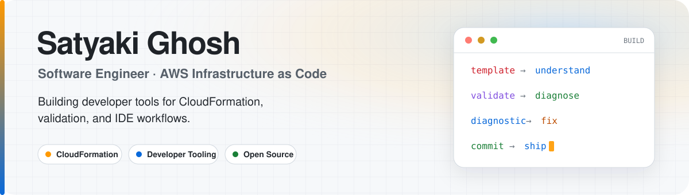

<picture>
  <source media="(prefers-color-scheme: dark)" srcset="./assets/profile-banner-dark.svg">
  <source media="(prefers-color-scheme: light)" srcset="./assets/profile-banner-light.svg">
  
</picture>

  
  
  

I build the tools around an infrastructure definition: the language server that understands it, the validators that catch mistakes, and the editor integrations that surface useful feedback while you work.

## What I work on

- **CloudFormation authoring:** language intelligence, diagnostics, schema-backed completions, and editor workflows.
- **Validation systems:** fast local feedback, precise source locations, and consistent behavior across tools.
- **Developer experience:** APIs, CLIs, IDE extensions, release tooling, and open-source maintenance.

## Open-source work

| Project | Focus | Public merged PRs |
| --- | --- | ---: |
| [CloudFormation Language Server](https://github.com/aws-cloudformation/cloudformation-languageserver) | Language intelligence and editor-facing diagnostics | [275+](https://github.com/aws-cloudformation/cloudformation-languageserver/pulls?q=is%3Apr+author%3Asatyakigh+is%3Amerged) |
| [CloudFormation Validate](https://github.com/aws-cloudformation/cloudformation-validate) | CloudFormation validation engine and integrations | [260+](https://github.com/aws-cloudformation/cloudformation-validate/pulls?q=is%3Apr+author%3Asatyakigh+is%3Amerged) |
| [CloudFormation for VS Code](https://github.com/aws-cloudformation/cloudformation-vscode) | CloudFormation authoring inside VS Code | [35+](https://github.com/aws-cloudformation/cloudformation-vscode/pulls?q=is%3Apr+author%3Asatyakigh+is%3Amerged) |
| [AWS CDK](https://github.com/aws/aws-cdk) · [VS Code Toolkit](https://github.com/aws/aws-toolkit-vscode) · [JetBrains Toolkit](https://github.com/aws/aws-toolkit-jetbrains) | Infrastructure-as-code and IDE experiences | 15+ |
| [CloudFormation Guard](https://github.com/aws-cloudformation/cloudformation-guard) · [cfn-lint](https://github.com/aws-cloudformation/cfn-lint) · [Enhanced Schemas](https://github.com/aws-cloudformation/resource-provider-enhanced-schemas) | Policy, linting, and resource schemas | 10+ |

Counts are rounded down from public GitHub data so they stay accurate as the work grows.

## Working across

  
  
  
  
  
  

---

  <a href="https://github.com/satyakigh?tab=repositories">Repositories</a> ·
  <a href="https://github.com/search?q=is%3Apr+author%3Asatyakigh&type=pullrequests">Pull requests</a> ·
  <a href="https://www.linkedin.com/in/satyakig">LinkedIn</a>

